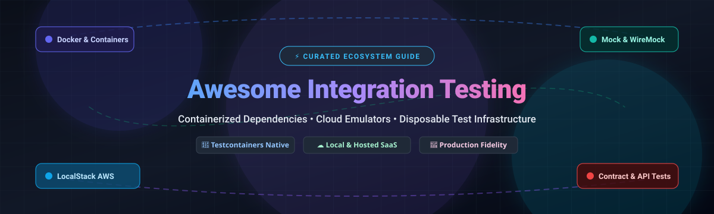

# 🚀 Awesome Integration Testing Tools

  
  
  
  
  

  

**A curated list of top integration testing frameworks, containerized test dependency orchestrators, API virtualization utilities, and cloud test infrastructure platforms.**

*Empower your CI/CD pipelines with realistic, reproducible, and disposable integration environments.*

---

## 📑 Table of Contents

- [🔍 Sector Overview & Market Dynamics](#-sector-overview--market-dynamics)
- [☁️ SaaS & Hosted Platforms](#️-saas--hosted-platforms)
- [🐙 Open-Source GitHub Projects](#-open-source-github-projects)
  - [Top Projects (Ranked by GitHub_Stars)](#top-projects-ranked-by-github-stars)
  - [Language Bindings & Framework Ecosystem](#language-bindings--framework-ecosystem)
- [🌟 Star History](#-star-history)
- [🤝 How to Contribute](#-how-to-contribute)
- [💖 Support & Sponsorship](#-support--sponsorship)
- [⚠️ Disclaimer](#️-disclaimer)

---

## 🔍 Sector Overview & Market Dynamics

The global software testing and quality engineering market is estimated at approximately **$50–$60 billion** (2025–2026), expanding at a CAGR of roughly 8–13%. The sector is **moderately fragmented**: while enterprise leaders (such as Tricentis, SmartBear, and BrowserStack) capture large commercial footprints, no single vendor commands a winner-take-all monopoly, leaving substantial market share distributed across open-source ecosystems, specialized cloud device clouds, and AI-driven testing startups.

---

## ☁️ SaaS & Hosted Platforms

A comprehensive overview of leading commercial SaaS platforms for API validation, real-device execution, and cloud containerized runtimes.

| 🏢 Product | 📈 Company Scale (Valuation / Revenue) | 💳 Pricing (Starting Tiers) | 🎁 Free Tier / Free Trial Limits | 📝 Description |
| :--- | :--- | :--- | :--- | :--- |
| **[Postman](https://www.postman.com/)** | $5.6B valuation (~$170M–$300M ARR) | Starts at $9/user/month (Solo, annual) or $19/user/month (Team, annual) | Free plan: 1 user, unlimited collection runs & mock servers, 1,000 API monitoring calls/month, 50 AI credits/month | API platform featuring collection-based automated testing, mock servers, and contract testing workflows. |
| **[Tricentis](https://www.tricentis.com/)** | $4.5B valuation (~$500M ARR) | Starts around $3,000/user/year (or core platform from €20,000/year) | 14-day free trial (full evaluation access to Tosca / qTest cloud features, no credit card required) | Enterprise-grade continuous testing and model-based test automation platform for complex integrated workflows. |
| **[BrowserStack](https://www.browserstack.com/)** | $4.0B valuation (~$225M ARR) | Starts at $29/user/month (Live Desktop, annual) or $99/parallel/month (Automate Desktop) | Free trial: 30 minutes Live testing (desktop/mobile, ~1 min/device limit), 60 minutes Automate, 100 screenshots; Percy visual tier free for 5,000 screenshots/month | Cloud device and browser testing cloud providing real device execution for web and mobile integration validation. |
| **[Docker Desktop](https://www.docker.com/products/docker-desktop/)** | $2.1B valuation (~$207M ARR) | Starts at $9/user/month (Pro, annual) or $15/user/month (Team, annual) | Free-forever Personal plan: Limited to personal use, education, and businesses with <250 employees AND <$10M revenue | Local container engine that developers and CI workflows use to run Testcontainers and containerized dependencies. |
| **[ReadyAPI (SmartBear)](https://smartbear.com/product/ready-api/)** | Private (~$500M ARR) | Starts at $1,000/license/year (individual module) or $4,700+/license/year (full bundle) | 14-day free trial (complete unrestricted access to all ReadyAPI functional, load, and virtualization modules) | API integration and testing suite providing service virtualization, security validation, and performance testing. |
| **[Sauce Labs](https://saucelabs.com/)** | Private (~$70M–$90M ARR) | Starts at $39/month (Live Testing, annual) or $149/month (Virtual Cloud, annual) | 28-day free trial: 60 automated/live testing minutes with 3 concurrent virtual machines | Enterprise cloud continuous testing platform offering real device grids, emulators, and virtual browser environments. |
| **[Katalon Studio](https://katalon.com/)** | Private (~$36M–$60M ARR) | Starts at $229/month (or $1,000/seat/year for Studio Enterprise); Cloud platform from $59/month | Free-forever plan: Local test creation & manual execution only; excludes CI/CD execution (no KRE) & capped at 2,000 TestOps uploads/month | Low-code test automation platform covering web, mobile, API, and desktop applications. |
| **[Testcontainers Cloud](https://testcontainers.com/cloud/)** | Division of Docker ($2.1B valuation) | Bundled in Docker Pro ($9/user/month, annual) or Team ($15/user/month, annual) | Docker Personal trial: evaluation access only; paid plans include 100 mins/mo (Pro) or 500 mins/mo (Team) before per-minute overages | Managed cloud container runtime for Testcontainers removing local daemon constraints and accelerating CI pipeline jobs. |
| **[Testsigma](https://testsigma.com/)** | Early-stage ($25M–$50M valuation / ~$8M–$10M ARR) | Test Management starts at $14/user/month; Automation Cloud plans start via custom quotes | 21-day free trial of Automation Cloud (full access); self-hosted Community Edition is free (requires managing own infrastructure/device grid) | Cloud-based low-code and AI-driven automation platform supporting web, mobile app, and API integration tests. |

---

## 🐙 Open-Source GitHub Projects

Open-source tools provide transparent, self-hosted, and cost-effective test environments without recurring per-minute cloud fees. The repositories below are sorted in descending order by community GitHub Stars_Count.

### Top Projects (Ranked by GitHub_Stars)

1. **[LocalStack](https://github.com/localstack/localstack)**   
   ☁️ **Fully functional local cloud emulator for AWS.** Develop and test cloud and serverless integration apps entirely offline without spinning up live AWS resources. Emulates S3, Lambda, DynamoDB, SQS, SNS, Kinesis, and 80+ other services. Apache-2.0 licensed.  
   *Best for: Teams running integration tests against cloud architectures without incurring AWS cloud bills or dealing with credential sprawl.*

2. **[Keploy](https://github.com/keploy/keploy)**   
   📼 **Traffic-driven automated test and mock generator.** Records real API and database network traffic (HTTP, gRPC, GraphQL, Postgres, MySQL, MongoDB, Redis, Kafka) and replays it as deterministic integration tests with synthetic mocks. Utilizes eBPF on modern Linux and native packet capture on macOS/Windows. Apache-2.0 core.  
   *Best for: Zero-code integration test generation derived from staging and production user flows.*

3. **[Testcontainers (Java)](https://github.com/testcontainers/testcontainers-java)**   
   🐳 **The industry-standard disposable container testing library.** Provides lightweight, throwaway instances of Docker containers (PostgreSQL, MySQL, Redis, Kafka, Elasticsearch, Selenium browsers) for JUnit and Spock suites. MIT licensed.  
   *Best for: Eliminating brittle external test databases and testing against genuine production container images.*

4. **[WireMock](https://github.com/wiremock/wiremock)**   
   🔌 **Flexible HTTP mock server and proxy.** Allows stubs, record/replay of HTTP interactions, fault injection, rate limiting, and verification of outbound web service calls during integration workflows. Runs standalone or as an in-process Java rule. Apache-2.0 licensed.  
   *Best for: Mocking unstable or slow third-party HTTP/REST dependencies and simulating edge cases like latency and connection drops.*

5. **[Testcontainers (Go)](https://github.com/testcontainers/testcontainers-go)**   
   🐹 **Official Go implementation of Testcontainers.** Provides idiomatic Go programmatic container lifecycle orchestration using the official Docker Go SDK. Pre-configured modules for Postgres, Redis, Kafka, and OpenSearch. MIT licensed.  
   *Best for: Go backend engineers writing fast, reliable integration tests with clean container teardown.*

6. **[MockServer](https://github.com/mock-server/mockserver-monorepo)**   
   🛡️ **Enterprise mock server and proxy for HTTP/HTTPS.** Inspects, proxies, and mocks complex service dependencies with TLS/SSL handling, dynamic JavaScript callbacks, and expectation verifications. Available as a Docker container, CLI, or Maven plugin. Apache-2.0 licensed.  
   *Best for: Simulating microservice integration contracts with custom certificate validation and HTTPS proxying.*

7. **[Testcontainers (.NET)](https://github.com/testcontainers/testcontainers-dotnet)**   
   🔷 **Official .NET implementation of Testcontainers.** Built natively for modern .NET and C# with first-class support for `WebApplicationFactory`, xUnit, NUnit, and MSTest. MIT licensed.  
   *Best for: ASP.NET Core microservices requiring ephemeral SQL Server, PostgreSQL, or Azurite dependencies.*

8. **[Testcontainers (Node.js)](https://github.com/testcontainers/testcontainers-node)**   
   🟢 **Official Node.js / TypeScript binding for Testcontainers.** Effortlessly spins up test databases and message queues inside Jest, Mocha, or Vitest execution runs. MIT licensed.  
   *Best for: JavaScript and TypeScript fullstack backends needing isolated databases during test sweeps.*

9. **[Testcontainers (Python)](https://github.com/testcontainers/testcontainers-python)**   
   🐍 **Official Python implementation of Testcontainers.** Integrates seamlessly with `pytest` fixtures to provision databases, brokers, and local cloud services across integration scenarios. MIT licensed.  
   *Best for: Python backend frameworks (FastAPI, Django, Flask) requiring containerized integration tests.*

10. **[Pact (JS)](https://github.com/pact-foundation/pact-js)**   
    🤝 **Consumer-Driven Contract Testing framework.** Validates API contracts between microservice consumers and providers to prevent breaking schema changes without full multi-service deployments. Apache-2.0 licensed.  
    *Best for: Microservice architectures wanting to catch integration regression issues early in local builds.*

11. **[dockerlet](https://github.com/metastable-void/dockerlet)**   
    🦀 **Ultra-minimal Rust container wrapper.** A deliberately lightweight Bollard wrapper for provisioning ephemeral databases and brokers in Rust integration tests without heavy cryptographic dependency trees. Apache-2.0 licensed.  
    *Best for: Rust projects prioritizing lightning-fast build compilation and minimal dependency footprints.*

### Language Bindings & Framework Ecosystem

- **Multi-Language Testcontainers Stack**: Choose the native client library tailored to your language (`testcontainers-java`, `testcontainers-go`, `testcontainers-dotnet`, `testcontainers-node`, `testcontainers-python`).
- **Cloud & Mock Orchestration**: Pair container dependencies with **LocalStack** for AWS cloud services and **WireMock** / **MockServer** for resilient third-party HTTP APIs.
- **Contract Verification**: Use **Pact** to safeguard API schemas across asynchronous and REST microservice boundaries.

---

## 🌟 Star History

---

## 🤝 How to Contribute

Contributions are warmly welcome! You can help expand and refine this ecosystem directory:

1. 🍴 **Fork the repository** on GitHub.
2. 🌿 **Create a dedicated branch** (`git checkout -b feature/add-new-tool`).
3. 📝 **Add or edit entries** in `README.md` adhering to the tabular/ranked format and linking to official sources.
4. 🚀 **Submit a Pull Request** with a concise description of why the tool is valuable for integration testing.

---

## 💖 Support & Sponsorship

Thank you for exploring and using **Awesome-Integration-Testing-Tools**! If you find this directory valuable for your engineering team or testing workflows, please consider supporting the project:

- ⭐ **Star this repository** to help others discover it across GitHub.
- 🍴 **Fork and share** with colleagues and testing communities.
- ☕ **Buy a coffee or sponsor** ongoing maintenance via the [GitHub Sponsors Dashboard](https://github.com/sponsors/ishandutta2007).

Your encouragement and support keep open-source developer resources actively maintained!

---

## ⚠️ Disclaimer

- This list is **community-curated** for educational and reference purposes; inclusion does not constitute a formal commercial endorsement.
- **Docker Desktop Licensing**: Organizations with >250 employees or >$10M annual revenue require a paid subscription for commercial use. Docker Engine on Linux remains open-source.
- **Testcontainers Cloud Quotas**: Free evaluation minutes are limited; monitor team runtime minutes to prevent unexpected consumption overages.
- Verify software license terms and enterprise compliance standards before deploying tools into commercial CI/CD pipelines.

---

**Made with ❤️ for developers, QA engineers, and platform teams building reliable integration testing workflows.**

